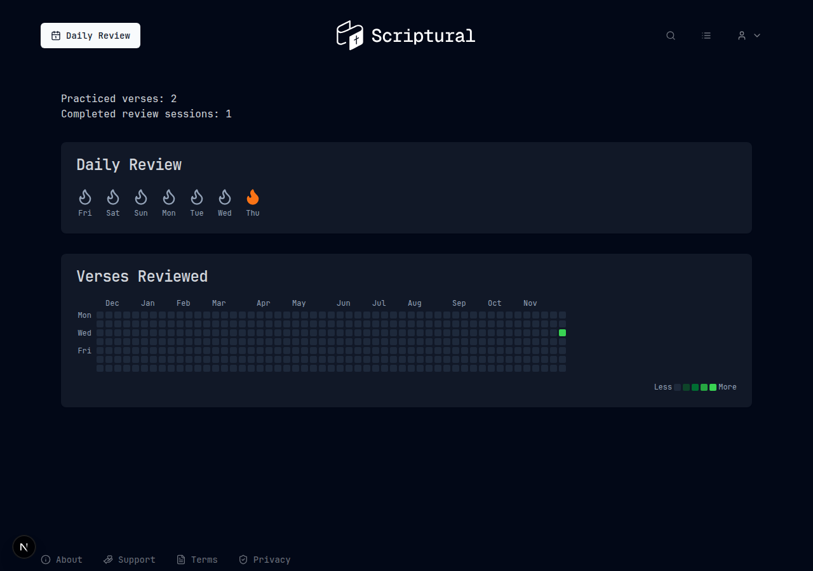

# 005: The heatmap and the streak put the same review on different days

**Severity:** Low
**Area:** `component-library/review-year-grid/index.tsx`, `app/page.tsx`
**PRD:** [Daily review](../prd/daily-review.md) R20 (the account timezone sets "my own day")

## Summary

The home **Daily Review** streak groups days in the account timezone (`users.timezone`). The **Verses Reviewed** heatmap calls `loadReviewYear(Intl.DateTimeFormat().resolvedOptions().timeZone)`, which uses the browser's timezone. When the two differ, one finished review shows up on two different days.

## Steps

1. Set the account timezone to `America/New_York` in **Account settings**.
2. In a browser set to `America/Los_Angeles`, finish a Daily Review at 10:30 PM Pacific (1:30 AM Eastern the next day).
3. Open home.

**Expected:** Both cards put the review on the same local day, the account's day.

**Actual:** The streak lights Thursday and the heatmap lights Wednesday.

