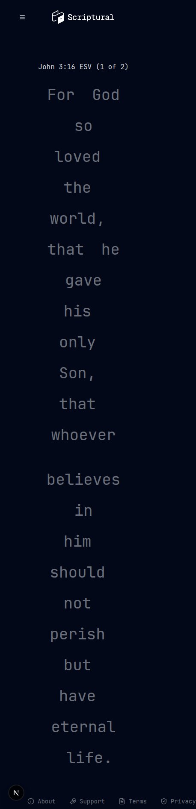
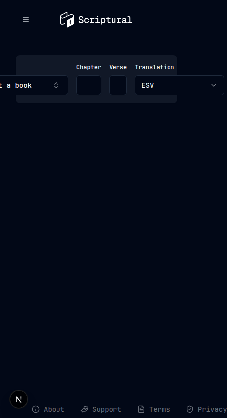

# 006: Pages other than the header and home overflow on a phone

**Severity:** Low
**Area:** `app/footer.tsx`, `component-library/verseTyper/index.tsx`, `app/(protected)/verse_sets/layout.tsx`, `app/(protected)/search/page.tsx`
**PRD:** None. #39 made the header and the review-year card fit small screens. This report covers the pages that change did not reach. Treat it as a feature that is not built yet if phones are not a target.

## Steps

Sign in and open each page at 390 × 844.

| Page | Result |
| --- | --- |
| Every page | The footer (`flex gap-8 mx-8 px-8`, no wrap) is 68px wider than the screen. "Privacy" is cut off and the page scrolls sideways. |
| `/review` | `VerseTyper` uses fixed `mx-32` margins, so the passage is 173px wide and shows about one word per line. |
| `/verse_sets/<id>` | The fixed `w-80` Verse Sets card is pushed off the left edge. |
| `/search` | The form row does not wrap, and the Book picker is cut off on the left. |

```
FAIL  mobile /review: no horizontal overflow  -- overflow 68px
FAIL  mobile /review: verse text uses most of the width  -- verse width 173px of 390px
FAIL  mobile /verse_sets: no horizontal overflow  -- overflow 68px
FAIL  mobile /account: no horizontal overflow  -- overflow 68px
FAIL  mobile /search: no horizontal overflow  -- overflow 68px
```



